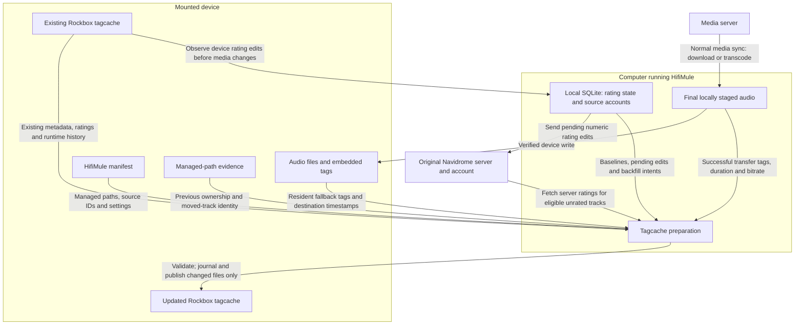
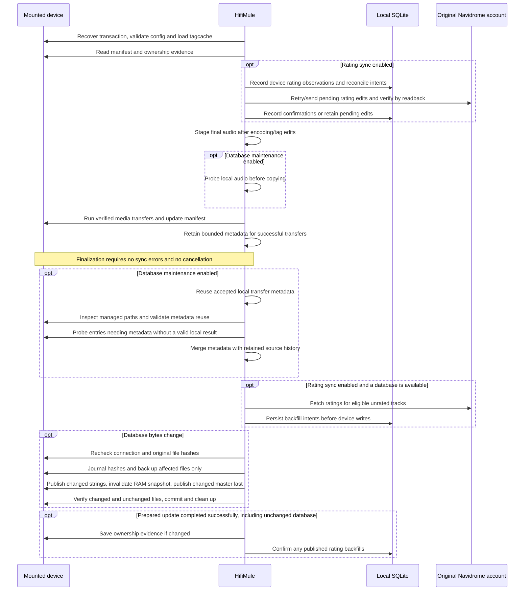

# Rockbox tagcache: data sources and files

HifiMule builds Rockbox's database from **final staged audio on the computer** for successful transfers, and **audio files on the mounted device** for resident entries needing metadata.
It reads the existing device database to preserve playback history and ratings,
and optionally contacts **Navidrome** to exchange numeric ratings. The device
manifest identifies which files belong to which server tracks; HifiMule's local
SQLite database remembers rating observations and unfinished work.

See [Rockbox database and ratings](./rockbox-database.md) for setup and recovery
guidance. Both maintenance and rating sync are opt-in. This implementation requires
mounted mass storage and an existing `.rockbox` directory; MTP and custom database
locations are unsupported.

## Where each value comes from

The media server is an upstream source of downloaded audio, but tagcache
maintenance does not fetch its album/title metadata from the server library API.
For transfers it probes the final local file after encoding and tag edits, then accepts the metadata only after a verified device write and manifest update. Resident entries needing metadata are probed on the device. An unchanged managed entry can retain its existing tags without
another probe.

| Data written or retained | Immediate source | How it is used |
| --- | --- | --- |
| Artist, album, genre, title, composer, comment, album artist, grouping | Final local audio tags for transfers; device audio tags for resident fallback | Read through `probe_path` locally or `probe` on the device; missing text becomes `<Untagged>`. New text is bounded to 520 UTF-8 bytes. |
| Year, disc number, track number | Final local audio tags for transfers; device audio tags for resident fallback | Parsed into numeric fields; missing values become zero. |
| Bitrate and duration | Final local audio probe or resident device probe | Stored as kbps and milliseconds. |
| File modification time | Device filesystem | Stored in the index and used when deciding whether to refresh a track. |
| Canonical artist (4.0) | Derived from scanned artist and album artist | Uses artist unless it is `<Untagged>`, then album artist. |
| Firmware filename | Manifest's relative path plus configured Rockbox prefix | For example, `Music/song.mp3` with `/<microSD0>` becomes `/<microSD0>/Music/song.mp3`. No suffix-based volume guessing. |
| Rating, play count, play time, last-played and resume values | Existing device tagcache | Retained for the same tracked source, including an unambiguous move to a new path. A different source at the same path does not inherit history. |
| Initial rating for an eligible unrated track | Original Navidrome server/account | Server 1–5 becomes Rockbox 2, 4, 6, 8 or 10. Existing positive device ratings are preserved. |
| Device rating edits sent to Navidrome | Existing device tagcache, compared with local SQLite state | Rockbox 1–10 becomes server 1–5, rounding upward. Initial zero is unrated; zero after an observed positive rating is a clear. |
| Existing unmanaged tracks and their metadata | Existing device tagcache | Preserved, including tracks belonging to other storage prefixes. |
| Format, byte order and build counters | Existing tagcache, or settings for a new database | Existing format and byte order are retained; changed builds regenerate build metadata, while unchanged maintenance preserves the original bytes and commit counter. |

Rating lookups use bounded server pages. Source IDs, ownership and account checks
prevent updates from being sent to a different track or account. Local SQLite
state prevents unchanged device ratings from overwriting later server edits and
prevents server backfills from being echoed back as device edits. Favorites are
separate from numeric ratings.

## Files used on the device

The following is the file inventory for this integration. Paths beginning with
`.rockbox/` are relative to the mounted device root. Audio filenames vary with
the sync layout.

| File | Read/write role and purpose |
| --- | --- |
| Managed audio files, such as `Music/song.mp3` | Resident files are read when metadata needs refreshing; successful transfers reuse their final local metadata. Tagcache maintenance does not rewrite audio. |
| `.hifimule.json.zst` | Device manifest managed by the device layer. Supplies synchronized items, source server/track IDs, relative paths and Rockbox settings. |
| `.hifimule.json` | Legacy manifest accepted by the device layer and migrated to the compressed format. |
| `.rockbox/config.cfg` | Read, when present, to reject a custom `database path`. |
| `.rockbox/database_idx.tcd` | Read/write master index: track rows, offsets into string files, numeric metadata, runtime fields, flags and database header. Published last. |
| `.rockbox/database_0.tcd` | Read/write artist strings. |
| `.rockbox/database_1.tcd` | Read/write album strings. |
| `.rockbox/database_2.tcd` | Read/write genre strings. |
| `.rockbox/database_3.tcd` | Read/write title strings, associated with individual track rows. |
| `.rockbox/database_4.tcd` | Read/write firmware-visible filenames, associated with individual track rows. Paths must be valid UTF-8. |
| `.rockbox/database_5.tcd` | Read/write composer strings. |
| `.rockbox/database_6.tcd` | Read/write comment strings. |
| `.rockbox/database_7.tcd` | Read/write album artist strings. |
| `.rockbox/database_8.tcd` | Read/write grouping strings. |
| `.rockbox/database_12.tcd` | Read/write canonical artist strings, **Rockbox 4.0 only**. |
| `.rockbox/database_state.tcd` | Existing RAM database snapshot: fingerprinted and backed up if present, then invalidated only when database contents change. Unchanged maintenance retains it. |
| `.rockbox/database_tmp.tcd` | Pending Rockbox database work. Its presence blocks admission; commit the work on the player first. |
| `.rockbox/database_changelog.txt` | Pending Rockbox changes. A nonempty file blocks admission; an empty file is allowed. |
| `.rockbox/.hifimule-rbdb-managed.json` | HifiMule ownership evidence: previous managed paths, source identities and prefixes. Supports safe removal and history preservation across moves or interrupted syncs. Updated after successful database publication. |
| `.rockbox/.hifimule-rbdb-journal.json` | Transaction state and old/new file hashes. Written only when database files change and read during recovery; removed after cleanup. Includes hashes for unchanged files to detect conflicts. |
| `.rockbox/.hifimule-rbdb-backup/<filename>` | Prior versions of files affected by publication, including the master, string files and RAM snapshot when present. Used for rollback and removed after recovery/commit cleanup. |
| `.rockbox/.hifimule-rbdb-backup/.hifimule-rbdb-stage-<filename>` | Temporary backup writes, renamed into completed backup files after flushing. Recovery handles interrupted staging. |
| Temporary files with generated names beside their destination | Used by `atomic_file` to write and flush a complete file before replacing the destination. These are implementation artifacts, not additional Rockbox inputs. |

There are no separate `database_9.tcd`, `database_10.tcd` or
`database_11.tcd` inputs in this implementation: year, disc and track are numeric
slots in the master. Other numeric fields also live in the master.

Rockbox 3.15 uses format version 15 and 22 tag slots; 4.0 uses version 16 and
23 slots, adding canonical artist. Both little- and big-endian existing files
are supported; new databases use little-endian. A valid database needs the
master and all string files required by its version. Orphaned `database_*.tcd`
files without a master are treated as an incomplete database.

## Files and state on the computer

| File or logical store | Purpose |
| --- | --- |
| Final audio files in the existing temporary staging directory | Read after encoding/tag edits and before copying. Deleted after transfer; only bounded metadata survives until finalization. |
| `hifimule.db` in HifiMule's application data directory | Local SQLite database. Source server/account records resolve the original provider. The `rockbox_ratings` table stores observed and confirmed device ratings plus initialization state. The `rockbox_rating_backfills` table records intended server-to-device writes before publication, so interrupted writes can be reconciled. These are tables, not separate files. |

Navidrome ratings are fetched through provider API calls, not from a downloaded
rating file. The existing tagcache supplies playback history; server play counts
and resume positions are not used to populate these Rockbox fields.

## When reads and writes happen

With maintenance disabled, ratings-only sync can patch an existing master index
without scanning audio metadata. It does not create a missing database. With
maintenance enabled, a database can be created even when no transfers are needed.

Missing or unreadable managed audio produces a per-track warning: an existing
source entry and its history are retained for retry, while a new track remains
unindexed. Invalid structure, unsupported versions or conflicting ownership abort
publication. Handled publication failures roll back; interrupted transactions
recover on the next enabled sync. Replacement spans multiple files, so a device
interrupted during publication should reconnect to HifiMule before Rockbox use.
Recovery refuses to overwrite externally changed files.

## Implementation references

- [Tagcache codec, ownership, ratings and publication](../hifimule-daemon/src/rockbox.rs): `RbDatabase`, `Session`, `publish`, `recover`.
- [Sync ordering and finalization](../hifimule-daemon/src/sync.rs): `execute_provider_sync`, `publish_rockbox_update`.
- [Device audio metadata probe](../hifimule-daemon/src/device_music_scan.rs): `probe`.
- [Device manifest format](../hifimule-daemon/src/device/manifest_codec.rs).
- [Local rating tables](../hifimule-daemon/src/db.rs).
- [Independent binary fixtures](../hifimule-daemon/tests/fixtures/rockbox/generate.py).

## Incremental maintenance and diagnostics

Final local probes run at the common device-writer entry point, after all producer
encoding/tag edits. They are cancellable, and the worker joins before its staged
file is removed. Only successful writes and accepted manifest updates contribute
metadata. The session retains at most 64 MiB of transfer metadata; excess entries
use the normal device fallback. Actual destination size and modification time
validate reuse. Local staging timestamps are never stored as device timestamps.

Resident entries still undergo filesystem and ownership checks to detect external
changes. A fully unchanged database keeps its original bytes and commit counter and creates
no publication journal or backup. Ownership evidence is written only if it changes.
Publication backs up and replaces byte-changed files only, checks unchanged files
for conflicts, and invalidates the RAM snapshot only for a database change.
Ratings-only updates therefore leave string files untouched. Recovery remains
on the device with the master published last.

An empty 40,000-track managed database with 200 local transfer results still needs
roughly 39,800 resident probes. No persistent metadata cache is introduced.

`[Rockbox]` logs report local probe time/success, inspected and retained entries,
accepted local metadata, device probe counts, and inspection/probe durations.
Publication reports changed and unchanged file counts and output bytes when files
are replaced. See [maintenance diagnostics](./sync-performance.md#rockbox-database-maintenance)
for phase timings and guidance on comparing initial and incremental syncs.
